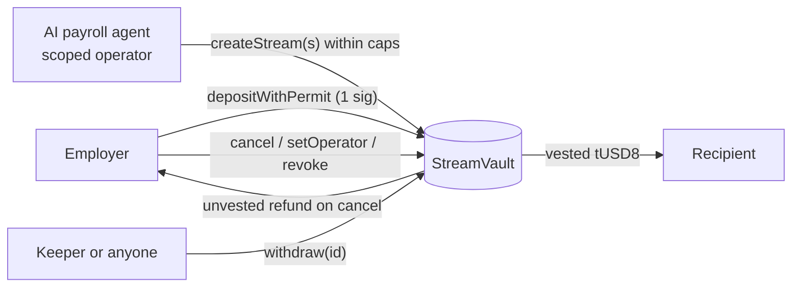

# PayStream — payroll & vesting streams on QDay Aevum

Entry for **Aevum Builder Challenge #1** (QDay × DoraHacks) — track: payroll and vesting.

Employers fund a treasury in **tUSD8** (one EIP-2612 signature), then create cliff + linear
streams for employees or token-vesting beneficiaries, singly or as a batch. Recipients (or any
keeper/relayer) pull what has vested. A human or an AI payroll agent can be given a **scoped,
expiring, revocable operator role** with per-stream and daily spend caps.

## Why it is safe by construction
| Control | Where |
| --- | --- |
| Operator = create-only; cannot cancel, cannot touch the treasury | `StreamVault._authorize` |
| Per-stream cap, daily cap (resets per UTC day), hard expiry | `Operator` struct |
| Instant revocation | `revokeOperator` |
| Vested funds are never clawed back; cancel refunds only the unvested part | `cancel` |
| Non-cancelable (irrevocable vesting) streams | `cancelable=false` |
| Full on-chain audit trail | `StreamCreated` (includes `createdBy`), `Withdrawn`, `StreamCanceled` events |

## Architecture


## Network
| | |
| --- | --- |
| Chain | QDay Aevum testnet, id 44005 |
| RPC | https://rpc-test.qday.info |
| Explorer | https://explorer-test.qday.info |
| tUSD8 | `0x456569838f1d43009A91ebA4263147Afd7233483` (6 decimals) |
| Faucet | https://faucet.qday.info |

## Run
```bash
forge install OpenZeppelin/openzeppelin-contracts foundry-rs/forge-std
forge test -vv
export PRIVATE_KEY=0x...   # testnet-only key funded from the faucet
forge script script/Deploy.s.sol --rpc-url aevum --broadcast --legacy --private-key $PRIVATE_KEY
```
Compiled for the Shanghai EVM (Aevum is a cdk-erigon zkEVM). Tests use a local 6-decimals
permit token; fork tests against the real tUSD8 can be added with `--fork-url aevum`.

## Known constraints
- Single token (tUSD8) per vault; streams are not transferable NFTs.
- Rounding: vesting uses integer division, so up to 1 base unit may lag until `end`.
- Unaudited hackathon code, testnet only.
