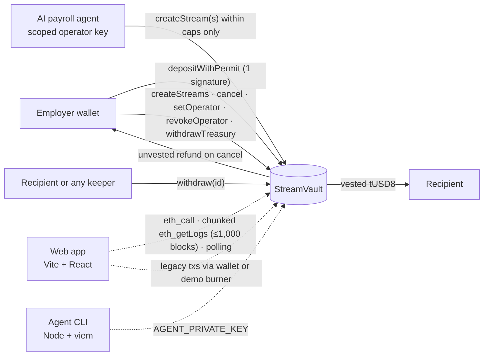
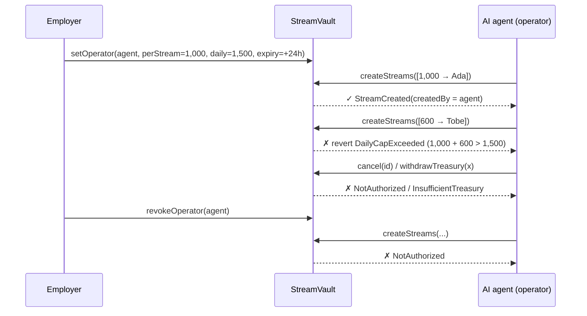

# PayStream

**Payroll that streams by the second, with an AI agent that physically cannot overspend.**

Entry for **Aevum Builder Challenge #1** (QDay × DoraHacks), payroll and vesting track.
Runs on **QDay Aevum testnet (chain 44005)** with **tUSD8 test tokens only**. Unaudited hackathon code, MIT licensed.

| | |
| --- | --- |
| Live demo | _PLACEHOLDER: filled after the web app is deployed_ |
| StreamVault (Aevum 44005) | _PLACEHOLDER: filled from `deployments/aevum-44005.json` after deployment_ |
| Demo video | _PLACEHOLDER_ |
| Demo script | [DEMO.md](DEMO.md) |

## The problem

Payroll is a batch job from the 1970s: money sits idle for a month, then moves in one lump. Crypto payroll tools
copied that model, and the new idea everyone wants (let an AI agent run payroll) usually means handing a bot a hot
key that can move the whole treasury. One prompt injection or leaked key and the company is drained.

## The solution

PayStream turns pay into streams and turns the agent into a **least-privilege operator** whose limits live in the
contract, not in the agent's prompt.

1. **Fund once.** The employer deposits tUSD8 into their treasury inside `StreamVault` with a single EIP-2612 permit signature.
2. **Stream payroll.** Cliff + linear streams for salaries, contractors or token/equity vesting, one at a time or as a batch in one transaction.
3. **Claim any second.** Recipients pull what has vested whenever they like. Anyone can trigger a payout for them ("keeper" mode), and the money always goes to the recipient.
4. **Delegate safely.** Grant an AI payroll agent (or a human ops person) an operator role with a **per-stream cap**, a **daily cap** and an **expiry**. It can only create streams from the treasury. It can never cancel streams or withdraw funds, and the employer can revoke it instantly.

## Architecture



### Agent overspend sequence



More detail in [docs/ARCHITECTURE.md](docs/ARCHITECTURE.md).

## Safety model

| Control | Enforced by | Effect |
| --- | --- | --- |
| Least privilege | `_authorize` only gates `createStream(s)`; `cancel`, `withdrawTreasury`, `setOperator` check `msg.sender` | An operator can create streams and nothing else |
| Per-stream cap | `PerStreamCapExceeded` | No single stream above the cap, checked per row in a batch |
| Daily cap | `DailyCapExceeded` | Total created per UTC day is bounded |
| Expiry | `OperatorExpired` | Grants die on their own |
| Instant revocation | `revokeOperator` | One transaction, effective next block |
| Funded from treasury only | `InsufficientTreasury` | Agents cannot pull from the employer's wallet |
| No claw-back | `cancel` freezes `total` at the vested amount | Vested pay stays claimable after cancel |
| Irrevocable vesting | `cancelable = false` → `NotCancelable` | Grants that nobody, including the employer, can cancel |
| Audit trail | `StreamCreated(..., createdBy)`, `Withdrawn(..., triggeredBy)`, `OperatorSet/Revoked` | Every action is attributable on-chain |
| No admin | No owner, no upgradeability, no pause | Nobody can change the rules after deployment |
| Reentrancy | OpenZeppelin `ReentrancyGuard` + `SafeERC20` | |

Threat model and known limits: [docs/SECURITY.md](docs/SECURITY.md).

## Repository layout

| Path | What |
| --- | --- |
| `src/StreamVault.sol` | The contract |
| `test/` | Unit + fuzz (`StreamVault.t.sol`), invariants (`invariant/`), fork tests against real tUSD8 (`fork/`) |
| `script/Deploy.s.sol` | Deployment script |
| `scripts/sync-artifacts.mjs` | Generates TypeScript ABIs and writes `deployments/aevum-44005.json` from the real broadcast log |
| `web/` | The dApp (Vite, React 18, Tailwind, framer-motion, viem, TanStack Query, Zustand) |
| `agent/` | AI payroll agent CLI (operator key) |
| `packages/paystream-sdk/` | `@paystream/sdk`: reusable typed viem helpers |
| `docs/` | Architecture, security, verification |

## Environment variables

| Variable | Used by | Purpose |
| --- | --- | --- |
| `PRIVATE_KEY` | `forge script` | Employer/deployer key. **Testnet only**, needs tQDAY for gas |
| `AGENT_PRIVATE_KEY` | `agent/` CLI | Operator key for the AI payroll agent. **Testnet only** |
| `AEVUM_RPC_URL` | CLI, scripts | Optional RPC override (default `https://rpc-test.qday.info`) |
| `VAULT_ADDRESS` | CLI | Optional vault override (default: `deployments/aevum-44005.json`) |
| `VITE_VAULT_ADDRESS`, `VITE_VAULT_DEPLOY_BLOCK` | web build | Optional overrides for the deployment JSON |
| `VITE_RPC_URL` | web build | Optional RPC override |
| `VITE_BASE` | web build | Base path, e.g. `/paystream/` for GitHub Pages |
| `VITE_ASSISTANT_LLM` | web build | `1` shows the optional LLM hook; the assistant works fully without it |

Copy [`.env.example`](.env.example) to `.env`. `.env` is git-ignored; never commit a key.

## Network

| | |
| --- | --- |
| Chain | QDay Aevum testnet, id `44005`, gas token tQDAY |
| RPC | https://rpc-test.qday.info (HTTPS only, no WebSocket: the app polls) |
| Explorer | https://explorer-test.qday.info |
| Faucet | https://faucet.qday.info, or `/faucet <address>` on the QDay Discord |
| tUSD8 | `0x456569838f1d43009A91ebA4263147Afd7233483`, 6 decimals, EIP-2612 + EIP-3009 |
| tUSD8 EIP-712 domain | name `tUSD8`, version `2` (read at runtime and asserted against `DOMAIN_SEPARATOR()`) |
| EVM | Shanghai; legacy (type 0) transactions; `eth_getLogs` limited to 1,000 blocks |

## Reproduce it

Prerequisites: [Foundry](https://book.getfoundry.sh), Node 20+ and pnpm 9+ (or Docker for the web app only).

```bash
git clone --recurse-submodules https://github.com/teethaking/paystream && cd paystream

# 1. Contracts: unit, fuzz and invariant tests
forge test -vv

# 2. Fork tests against the real tUSD8 on Aevum (real permit signature with the on-chain domain)
forge test --match-path 'test/fork/*' --fork-url https://rpc-test.qday.info -vv

# 3. Deploy (testnet key funded from the faucet)
cp .env.example .env && $EDITOR .env && source .env
forge script script/Deploy.s.sol --rpc-url aevum --broadcast --legacy
node scripts/sync-artifacts.mjs        # writes deployments/aevum-44005.json + TS ABIs from the broadcast log

# 4. Web app
pnpm install
pnpm --filter @paystream/web dev       # http://localhost:5173
#   or, one command for judges:
docker compose up --build              # http://localhost:8080

# 5. Agent CLI (after the employer grants the agent in the app)
AGENT_PRIVATE_KEY=0x… pnpm agent status --employer 0xEmployer
AGENT_PRIVATE_KEY=0x… pnpm agent run agent/payroll.example.json
AGENT_PRIVATE_KEY=0x… pnpm agent overspend --employer 0xEmployer

# 6. TypeScript tests
pnpm -r test
```

No wallet? Click **Try instant demo** in the app. It creates a throwaway burner key in your browser (clearly marked
TESTNET ONLY); fund it from the faucet with the **Get test funds** button.

## Tests

| Suite | Command | What it proves |
| --- | --- | --- |
| Unit + fuzz | `forge test --match-path test/StreamVault.t.sol` | Vesting math, cliff, cancel split, batching, permit, every operator rule; fuzzed conservation of funds |
| Invariants | `forge test --match-path 'test/invariant/*'` | Random sequences of all actions (incl. over-cap agent batches and token donations): vault balance ≥ treasuries + everything owed; operator never exceeds caps; payouts + refund never exceed a stream's total |
| Fork | `forge test --match-path 'test/fork/*' --fork-url https://rpc-test.qday.info` | Real tUSD8: decimals, EIP-712 domain = on-chain separator, real permit deposit, wrong-version permit rejected, full operator lifecycle |
| SDK | `pnpm --filter @paystream/sdk test` | BigInt money helpers, vesting math parity, cap replica, error decoding, log chunking |
| Agent | `pnpm --filter @paystream/agent test` | payroll.json validation |
| Web | `pnpm --filter @paystream/web test` | Assistant parser and app helpers |

## `@paystream/sdk`: reuse it

[`packages/paystream-sdk`](packages/paystream-sdk) packages the ABI, an Aevum viem chain, 6-decimal BigInt money
helpers, an exact off-chain replica of the vesting and cap math, permit domain discovery with on-chain assertion,
1,000-block chunked log fetching with backoff, and plain-language decoding for every custom error. The web app and
the agent CLI both use it, and other Aevum builders can too.

## Known constraints

- **Unaudited hackathon code. Testnet only.** Do not use with real funds.
- One token (tUSD8) per vault; streams are not transferable (no NFT wrapper yet).
- Vesting uses integer division, so a stream can lag by under 1 base unit (0.000001 tUSD8) until `end`.
- Cap days are UTC days from block timestamps. Re-granting an operator (`setOperator` again) resets its spent-today counter; that is the employer's choice, but worth knowing.
- A compromised operator key can still create streams up to its caps until revoked or expired, to arbitrary recipients. Caps bound the damage; they do not prevent it. Use cancelable streams for agent-created payroll so the employer can claw back unvested amounts.
- The web app has no backend: history comes from `eth_getLogs` in 1,000-block chunks, cached in `localStorage`.
- Explorer source verification may not be available on Aevum; see [docs/VERIFICATION.md](docs/VERIFICATION.md) for byte-for-byte reproduction.

## Roadmap

- **SDK** published to npm, plus React hooks.
- **ERC-8004 identity** for agents, so an operator grant can name a verifiable agent, not just a key.
- **Mainnet** after QDay's Aevum mainnet in February, following an audit.
- **ERC-4337 session keys + paymaster**: operator grants as session keys, with gas paid in tUSD8.
- **NFT-wrapped streams** so recipients can transfer or borrow against future pay.

**Monetization:** a small protocol fee on stream creation (for example 0.1%, capped), and a Pro dashboard with
accounting exports, multi-sig employers and agent policy templates.

## License

[MIT](LICENSE)
