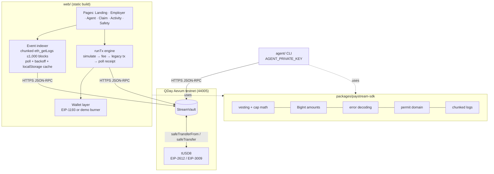
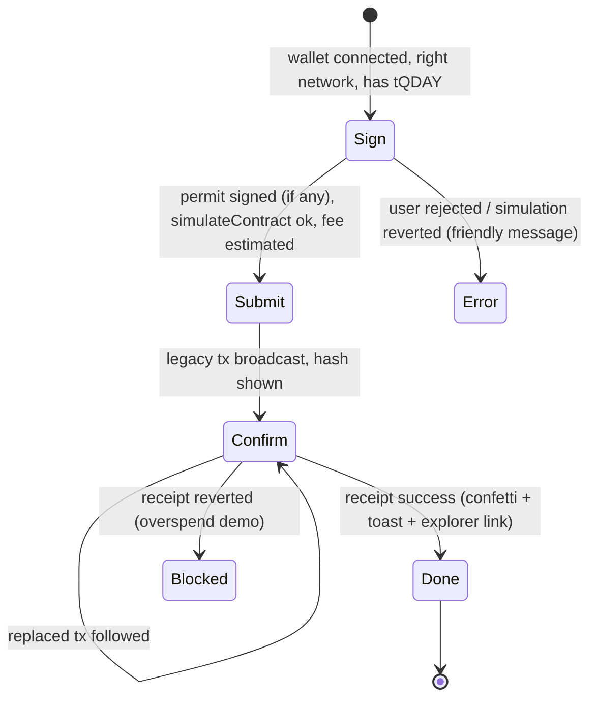

# Architecture

PayStream has three parts and no backend: one immutable contract, a static web app that reads the chain directly,
and a CLI that plays the AI payroll agent. All three share `@paystream/sdk`.

## Contract: `StreamVault`

State:

- `treasury[employer]`: unallocated tUSD8 per employer.
- `_streams[id]`: `{sender, recipient, total, withdrawn, start, cliff, end, cancelable, canceled}` packed into 3 slots.
- `operators[employer][operator]`: `{perStreamCap, dailyCap, expiry, dayIndex, spentToday}`.

Vesting: `0` before `cliff`, `total * (t - start) / (end - start)` between cliff and end, `total` at or after
`end`. A cliff therefore releases the linear amount accrued since `start` in one step. On `cancel`, `total` shrinks to
the vested amount, so the recipient keeps exactly what had vested and the unvested remainder goes back to the employer's
wallet (not the treasury).

Operator authorization (`_authorize`) runs per stream, including inside a batch, so a batch is checked row by row and
the whole transaction reverts if any row breaks a cap. The daily counter resets lazily when the UTC day index changes.

There is no owner, no pause and no upgrade path.

## Web app data flow

The app treats events as the source of truth and derives everything from them, then re-checks the numbers that matter
against `eth_call`:

| Need | Source |
| --- | --- |
| Streams (including withdrawn and canceled state) | `StreamCreated`, `Withdrawn`, `StreamCanceled` (`lib/derive.ts`) |
| Operators, agent activity log | `OperatorSet`, `OperatorRevoked`, `StreamCreated.createdBy` |
| Treasury | Derived from events, confirmed by `treasury(employer)` every 15 s |
| Operator usage | Derived, confirmed by `operators(employer, agent)` every 15 s |
| Claimable amount | Interpolated every animation frame with the contract's formula, re-anchored to `withdrawableOf` and the latest block timestamp |

Because Aevum's RPC has no WebSocket and caps `eth_getLogs` at 1,000 blocks, the indexer scans forward from the
deployment block in 1,000-block windows, retries with exponential backoff, caches results in `localStorage`, polls
every 6 s and pauses while the tab is hidden.

## Transaction lifecycle (`web/src/lib/tx.ts`)

## Permit deposit

1. Read the token's EIP-712 domain: `eip712Domain()` if implemented, otherwise `name()` and `version()`, falling back to `tUSD8` / `2`.
2. Recompute the domain separator and assert it equals `DOMAIN_SEPARATOR()` before asking the user to sign.
3. Sign `Permit(owner, spender = vault, value, nonce, deadline)` off-chain.
4. `depositWithPermit(amount, deadline, v, r, s)`. If someone front-runs the permit, the call still succeeds as long as the allowance is in place.

On the real tUSD8, `eip712Domain()` reverts and `version()` returns `"2"`; the derived separator matches the on-chain
one (covered by `test/fork`).

## Agent

The agent is just another key. In the web demo it is a second burner in `localStorage`; in the CLI it is
`AGENT_PRIVATE_KEY`. The payroll assistant parses plain English deterministically into stream rows, replays the cap
logic off-chain (`checkOperatorCaps`) to predict PASS or BLOCKED, shows the exact calldata, and then lets the contract
have the final word.
